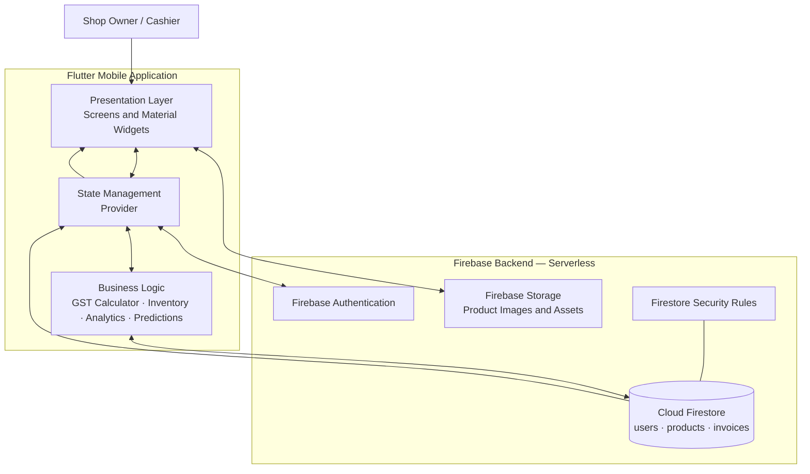
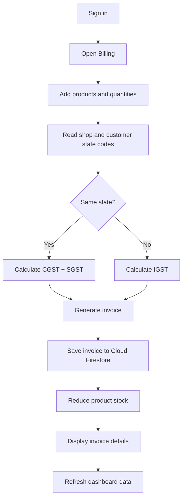

[README.md](https://github.com/user-attachments/files/34134595/README.md)
# Inventra Mobile Application

## Overview
Inventra is an AI-powered smart inventory and GST billing system designed for small retail shops. This mobile application aims to streamline business management by providing features for inventory management, GST billing, customer management, sales tracking, and AI-powered insights.

## Project Structure
The mobile application is structured as follows:

```
mobile/
├── lib/
│   ├── main.dart                # Entry point of the Flutter application
│   ├── core/                    # Core functionalities
│   │   ├── constants/           # Constant values used throughout the app
│   │   ├── theme/               # Application theme definitions
│   │   ├── utils/               # Utility functions and helpers
│   │   └── services/            # Services for API calls and business logic
│   ├── models/                  # Data models for the application entities
│   ├── repositories/            # Repository classes for data access
│   ├── providers/               # State management providers
│   ├── features/                # Feature-specific functionalities
│   │   ├── auth/                # Authentication features
│   │   ├── dashboard/           # Dashboard functionalities
│   │   ├── inventory/           # Inventory management features
│   │   ├── billing/             # Billing functionalities
│   │   ├── customers/           # Customer management features
│   │   ├── sales/               # Sales records management
│   │   ├── analytics/           # Analytics and reporting features
│   │   └── settings/            # Application settings management
│   └── widgets/                 # Reusable UI components
├── test/                        # Unit and widget tests
├── pubspec.yaml                 # Flutter project configuration
└── README.md                    # Documentation for the mobile application
```

## Setup Instructions
1. **Clone the Repository**
   ```
   git clone <repository-url>
   cd inventra/mobile
   ```

2. **Install Dependencies**
   Make sure you have Flutter installed. Run the following command to get the required packages:
   ```
   flutter pub get
   ```

3. **Firebase Configuration**
   - Set up a Firebase project and configure your app with the necessary credentials.
   - Update the `firebase` directory with your Firestore rules and indexes.# Inventra — AI-Assisted Smart Inventory & GST Billing

> A mobile-first inventory and Point of Sale (POS) application that helps small retailers manage products, generate GST invoices, monitor sales, and access AI-assisted business insights.


## Overview

Inventra is a cloud-connected mobile inventory and billing system designed for small and medium-sized retailers. It brings product management, automated intra-state/inter-state GST calculations, invoice records, sales analytics, and an AI assistant into one mobile workflow.

The application is built with **Flutter (Dart)** and uses **Firebase** for authentication, cloud data storage, and product assets. Its goal is to reduce manual billing work, improve stock visibility, and help shop owners make more informed restocking decisions.

## Key Features

- **Authentication:** User registration and sign-in using Firebase Authentication.
- **Inventory management:** Create, view, update, and delete product records, including price, stock quantity, and GST rate.
- **GST billing engine:** Determines the tax treatment from shop/customer state codes and applies **CGST + SGST** for intra-state sales or **IGST** for inter-state sales.
- **Invoice generation:** Creates invoice records with billed items, tax breakdown, totals, timestamps, and unique invoice IDs.
- **Automatic stock updates:** Reduces product stock quantities after an invoice is generated.
- **Sales analytics dashboard:** Visualizes sales and revenue data using interactive charts.
- **AI assistant and predictions:** Presents sales forecasts and stock-related insights through the prediction provider and AI Assistant screen.
- **Cloud synchronization:** Uses Cloud Firestore to synchronize application data across devices.
- **Mobile-first UI:** Provides Home, Billing, Inventory, and AI Assistant navigation with Flutter Material widgets.

## System Design & Architecture

Inventra uses a **three-layer, serverless architecture**. The mobile app contains the presentation and application logic; Firebase supplies managed backend services, so the project does not require a separately maintained custom server.



### Architecture layers

1. **Presentation layer — Flutter:** Renders the login, dashboard, billing, inventory, invoice-detail, and AI Assistant screens.
2. **Application logic and state — Dart + Provider:** Coordinates UI state, product operations, analytics, predictions, and GST calculations.
3. **Backend services — Firebase:** Firebase Authentication handles sign-in, Cloud Firestore stores application records, and Firebase Storage stores product images and assets. Firestore Security Rules govern data access.

### Invoice workflow



## Technology Stack

| Area | Technology | Purpose |
|---|---|---|
| Mobile app | Flutter | Cross-platform UI framework |
| Language | Dart (`>=3.2.0 <4.0.0`) | Application and business logic |
| State management | Provider (`^6.1.2`) | Shared state and data flow between screens |
| Authentication | Firebase Authentication (`firebase_auth ^5.7.0`) | User sign-in and registration |
| Database | Cloud Firestore (`cloud_firestore ^5.6.12`) | Cloud storage and real-time synchronization |
| File/asset storage | Firebase Storage | Product images and application assets |
| Charts | `fl_chart ^0.69.0` | Sales and revenue visualizations |
| Formatting | `intl ^0.19.0` | Currency, number, and date formatting |
| Invoice IDs | `uuid ^4.5.1` | Unique invoice identifiers |
| Vector graphics | `flutter_svg ^2.0.10` | SVG icons and graphics |
| Typography | `google_fonts` (Inter) | Consistent application typography |
| Development tools | Android Studio, VS Code, Flutter SDK | Development, dependency management, and execution |
| Version control | Git, GitHub | Source-code versioning and collaboration |

## Data Model

Cloud Firestore contains the following primary collections:

| Collection | Example information stored |
|---|---|
| `users` | Shop-owner details and shop GSTIN |
| `products` | Product name, price, stock quantity, and GST percentage |
| `invoices` | Billed items, final amount, tax breakdown, and timestamp |

The invoice flow connects billing records with inventory changes: when an invoice is generated, the sold quantities are deducted from stock.

## Project Structure

The main application code under `lib/` is organized by responsibility:

```text
lib/
├── app/                 # App configuration and theme
├── core/
│   └── utils/
│       └── gst_calculator.dart
├── providers/
│   ├── product_provider.dart
│   ├── analytics_provider.dart
│   └── prediction_provider.dart
└── screens/
    ├── home_screen.dart
    ├── invoice_detail_screen.dart
    └── ai_assistant_screen.dart
```

> This is a high-level structure based on the project report; add any additional folders or files that exist in your repository.

## GST Calculation Logic

Inventra extracts the two-digit state code from the shop and customer GSTINs (or uses supplied state codes) to choose the tax type:

- **Intra-state sale:** CGST and SGST are applied.
- **Inter-state sale:** IGST is applied.
- **Invoice creation:** The invoice and tax breakdown are saved, and stock is reduced.

The report documents unit tests for both tax paths and a fallback when the customer state cannot be determined. For production tax use, validate the GST rules and fallback behavior against current requirements before deployment.

## Testing & Reported Results

The report documents unit tests for GST calculation and manual functional/integration testing for invoice generation, Firestore updates, and analytics rendering.

| Test / metric | Reported result |
|---|---|
| Intra-state GST test | Passed: CGST + SGST applied |
| Inter-state GST test | Passed: IGST applied |
| Invoice persistence | Passed: invoice saved and Firestore updated |
| Analytics dashboard | Passed: charts rendered without frame drops |
| Database update latency | Reported below 1 second on a 4G connection |
| Billing time | Reported reduction of over 40% compared with manual billing |

*Performance figures are those stated in the project report and may vary with device, network, and workload. The report notes that structured trials with retail shop owners and cashiers have not yet been conducted.*

## Security & Design Considerations

- Firebase Authentication is used for user sign-in.
- Firestore Security Rules are intended to restrict data access.
- Managed cloud storage supports synchronization and reduces reliance on a single device.
- The current version depends on internet connectivity for Firestore synchronization.
- Native support for traditional dot-matrix printers is not included.

## Getting Started

### Prerequisites

- Flutter SDK and Dart (`>=3.2.0 <4.0.0`)
- Android Studio or VS Code
- An Android device or emulator
- A Firebase project with Authentication, Cloud Firestore, and Storage configured
- FlutterFire CLI for Firebase configuration

### Setup

1. **Clone the repository**
   ```bash
   git clone <YOUR_GITHUB_REPOSITORY_URL>
   cd <YOUR_PROJECT_DIRECTORY>
   ```

2. **Install dependencies**
   ```bash
   flutter pub get
   ```

3. **Configure Firebase**

   Configure your Firebase project for the app using the FlutterFire CLI. Ensure the generated `firebase_options.dart` and platform configuration files are present. Do not commit private credentials or sensitive configuration.

4. **Run the app**
   ```bash
   flutter run
   ```

> The report does not include a public repository URL or all platform-specific setup details. Replace the placeholders above and verify the setup instructions against your actual repository before publishing.

## Future Enhancements

- Add robust offline caching so billing can continue during network outages.
- Add camera-based barcode/QR scanning to populate the invoice cart.
- Integrate Bluetooth or Wi-Fi thermal receipt printers.
- Improve forecasting and restocking recommendations as more sales history becomes available.

## Team

Developed as a Mobile Application Development Project-Based Learning (PBL) project at **Chennai Institute of Technology**.

- **Jaisnav Krishna H S** — Backend and AI lead: Firebase integration, GST calculation logic, AI assistant/prediction.
- **Jayasurya P** — Frontend lead: Flutter UI, Provider state management, and analytics dashboard.

## Repository

**Source code:** Add your GitHub repository URL here.

## License

No license is specified in the project report. Add a license file if you intend to publish or distribute this project publicly.


4. **Run the Application**
   Use the following command to run the application on an emulator or connected device:
   ```
   flutter run
   ```

## Usage Guidelines
- **Authentication**: Users can register, log in, and manage their accounts.
- **Inventory Management**: Add, edit, and delete products. Monitor stock levels and receive alerts for low stock.
- **Billing**: Generate GST-compliant invoices and manage sales transactions.
- **Customer Management**: Keep track of customer details and purchase history.
- **Analytics**: View sales metrics and receive AI-generated insights.

## Contribution
Contributions are welcome! Please follow the standard Git workflow for submitting changes.

## License
This project is licensed under the MIT License. See the LICENSE file for more details.
